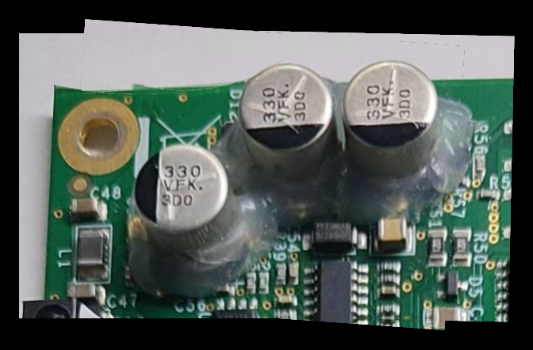

# PCB AR 标注

显微镜正上方摄像头的 PCB 扫描与元件 AR 标注。当前**主要可测能力**是：在清晰稳定的画面间隔拍照，把已拍区域用红色半透明覆盖贴在板面上，并在每拍一张后立刻把彩色关键帧拼进一张可打开查看的**整板总览图**。

下载安装后不必接摄像头也能测：用样例板 `SAMPLE-PARTIAL-001` 一键跑完整流程，或在界面里用「演示/合成帧」「使用样例画面」。

环境配置、锁定版本和常见问题见 [docs/ENVIRONMENT.md](docs/ENVIRONMENT.md)。仓库不含虚拟环境（`.venv` 绑定本机系统和 Python 版本，换机器不能直接用）。

Python 3.10+。核心依赖只有 `opencv-python`、`PyQt6`、`numpy`。本仓库不做打包，也没有 `ultralytics` / torch。

```bash
python -m venv .venv
source .venv/bin/activate
pip install -r requirements-dev.txt
```

只跑程序、不跑测试时，把上一行换成 `pip install -r requirements.txt`。要复现已验证版本可用 `pip install -r requirements-lock.txt`。也可以 `pip install -e ".[dev]"`。

## 启动界面

在仓库根目录：

```bash
PYTHONPATH=src python -m app.main
```

等价入口：

```bash
cd src && python -m app.main
```

默认视频源是摄像头 `0`。打开「扫描建图…」会立刻显示实时预览，不必先点「开始扫描」或「使用样例画面」。没有摄像头、打开失败、读帧超时，或 Windows 上 DirectShow 与 Media Foundation 都打不开时，会自动改用合成帧，并在界面用中文说明原因；窗口保持可操作。

- **扫描建图…**（`Ctrl+M`）：打开后左侧就是当前画面（摄像头或合成帧）。点「开始扫描」后，稳定了会自动拍第一张；重叠不足会拒绝并提示退回。
- **一键演示扫描**：用样例 `SAMPLE-PARTIAL-001` 自动跑完扫描，导出整板总览。
- **演示/合成帧**：手动改成合成画面。摄像头失败时程序也会自动切过去。

强制合成帧：

```bash
PYTHONPATH=src python -m app.main --source synthetic
```

完成扫描后，`overview.png`、`chain.json`、`topology_db.json` 写到 `artifacts/scan_maps/<板号-时间戳>/`，对话框会给出路径。总览是受约束的低分辨率预览（默认最长边 3200 px、最多约 800 万像素），不是全分辨率像素画布。

窗口标题是「PCB AR 标注」。主画面仍是底层视频加空标注层，右边是「元件参数」栏。跟踪与气泡标注还是桩，本轮重点是扫描生成整板图。

## 一键演示（无需界面）

没有显示器或只想先看结果时：

```bash
PYTHONPATH=src python -m app.main --demo-scan
```

指定输出目录：

```bash
PYTHONPATH=src python -m app.main --demo-scan --out artifacts/scan_maps/demo
```

成功时标准输出类似：

```
demo-scan ok: artifacts/scan_maps/demo/overview.png 652x408 shots=3
```

这会用 `assets/samples/SAMPLE-PARTIAL-001/global_ref.png` 裁出重叠视图，走与界面相同的稳定拍摄、红区跟踪和增量总览，不需要摄像头或 Qt 窗口。示例总览（672×442）：



也可以直接调用底层命令（同样写出 `overview.png`）：

```bash
PYTHONPATH=src python -m vision.stable_capture \
  --global assets/samples/SAMPLE-PARTIAL-001/global_ref.png \
  --out artifacts/stable_capture_map
```

无显示器检查主窗口仍能出帧：

```bash
QT_QPA_PLATFORM=offscreen PYTHONPATH=src python -m app.main --smoke
```

`--smoke` 收到第一帧后退出。成功时标准输出有一行 `smoke ok:`。

## 扫描规则（可测行为）

- 先点「开始扫描」，画面清晰且两帧之间几乎不动，才允许拍摄。
- 第一张在稳定后自动拍下；已拍区域用红色半透明覆盖跟着板面走。
- 下一张只要还有大约一到两成画面落在已拍区域里，并且几何位姿确定，就可以拍摄。位姿不确定时会提示放慢或稍退，不会默默要求红区占满大半个画面。
- 新的一张会和已经重叠的旧区域做回环，并在首张坐标系里一起修正位姿。重叠残差过大时不混合像素，保留更清晰的一块或留空，避免重影和双引脚。画布过大时会缩小重建，不会悄悄丢掉新瓦片。
- `render()` 仍然只在**当前帧**上画红区并集，不是整板图。整板图是 `overview_image()` / `overview.png`。标注写在板坐标里，不先画进瓦片再去拼接。
- 拓扑里的 `full_canvas` 仍为 `false`：这是预览，不是全分辨率画布。

## 已确认（v0.1.x 壳约定）

写进桩和文档，跟踪界面还没做：

- D1：矩阵是全局像素 → 当前帧像素。
- D2：允许纯像素工程；`absolute_pos_mm` / `pixel_per_mm` 可空，空着时侧栏警告。
- D3：主路径 LocalGlobal，仿射是降级。
- D4：跟踪丢失 TTL 0.8s，之后应冻结叠加并提示。常量在 `vision.policy`，计时器未接入。
- D5：`doubt`（`#FDD835`）留在枚举里，本轮界面不提供。
- D9 / D12：顶层 `status` 才是核对状态；气泡键就是 `name`、`value`、`package`。

D6–D8、D10–D11、D13–D14 已在 v0.1.2 确认：默认相机 0 / 近 4K / 无相机走合成帧，样例 zip 进 `assets/samples/`，路径相对 `assets/projects/`，运行时不用 pydantic。清单见 `docs/MILESTONES.md`。

## 拼接对照

样例板 `SAMPLE-PARTIAL-001`：15 张 `20261109-*.jpg` 是局部瓦片，`微信图片_20261109184831_115_34.jpg` 是全局整板对照（按文件名，不按尺寸）。

```bash
PYTHONPATH=src python -m vision.stitch_compare \
  --zip /path/to/局部图片.zip \
  --board-id SAMPLE-PARTIAL-001 \
  --out artifacts/stitch_compare
```

已经落在 `assets/samples/SAMPLE-PARTIAL-001/` 时：

```bash
PYTHONPATH=src python -m vision.stitch_compare \
  --board-dir assets/samples/SAMPLE-PARTIAL-001 \
  --board-id SAMPLE-PARTIAL-001 \
  --out artifacts/stitch_compare
```

OpenCV Stitcher 只在加 `--try-stitcher` 时试一次，失败会写进说明，不作为唯一结果。对照分数不够时 `ok` 为 false。视频拼接模块（`vision.mosaic`）仍是非默认备用路径。

## 测试

```bash
PYTHONPATH=src python -m pytest
```

计划与用例编号在 `docs/TEST_PLAN.md`。扫描总览与 `--demo-scan` 对应的测试在 `tests/test_overview_scan.py`。

## 现在有什么

- 稳定间隔扫描：`StableCaptureSession`（清晰/静止门控、红区跟踪、重叠拒绝、彩色增量总览、导出 `overview.png`）。
- 扫描工作台：`src/app/ui/scan_dialog.py`，从主窗口菜单/工具栏进入。
- `--demo-scan` 与「一键演示（样例）」，用 `SAMPLE-PARTIAL-001` 即可测整板图。
- `VideoCaptureThread`：`QThread`，信号 `frame_ready(object, float)`、`error(str)`、`stopped()`，`stop(wait_ms)` 可重复调用。`source` 可以是摄像头索引、视频路径，或 `"synthetic"`。
- `PCBAffineTracker` / `AffineResult`、`LocalGlobalTracker` / `HomographyResult`。`M` 是 2×3，`H` 是 3×3，方向都是**全局像素 → 当前帧像素**。LocalGlobal 是主路径，仿射是降级。主窗口里 `track()` 仍未接入逐帧配准。
- `BoardProject` / `Component` / `Fiducial` / `ProjectStore`。权威状态在元件的顶层 `status`。样例工程：`assets/projects/DEMO-PCB-001.json`。

## 现在还没有什么

- 主窗口上的实时 AR 标注、右侧栏表单和气泡编辑
- 回环闭合 / 位姿图优化（长距离扫描会有累积漂移）
- 全分辨率像素画布
- XYZ 机台标定（`src/calib/xyz.py` 调用会抛 `NotImplementedError`）
- 打包与可选检测依赖（YOLO / torch）

## 目录

```
src/app/main.py                 启动（含 --smoke、--demo-scan）
src/app/ui/main_window.py       主窗口
src/app/ui/scan_dialog.py       扫描建图工作台
src/app/ui/canvas.py            视频层 + 空标注层
src/app/ui/annotation_items.py  框 / 线 / 气泡类（未放上场景）
src/app/ui/sidebar.py           右侧占位
src/vision/stable_capture.py    稳定拍照、红区跟踪、彩色总览
src/vision/capture.py           采集线程
src/vision/policy.py            D1/D3/D4 常量（TTL 0.8s）
src/vision/affine_tracker.py    仿射降级桩
src/vision/local_global.py      主路径单应桩与 project_boxes
src/model/schema.py             JSON 结构与 STATUS_COLORS
src/model/store.py              读写与可见性过滤
src/calib/xyz.py                标定占位
assets/samples/SAMPLE-PARTIAL-001/
docs/ENVIRONMENT.md
docs/TECH_SPEC.md
docs/DATA_MODEL.md
docs/MILESTONES.md
docs/TEST_PLAN.md
tests/
```

规格原文也在仓库根的 `PROJECT_BRIEF.md` 和 `HANDOFF.md`。
